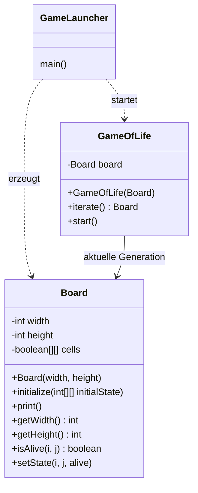

# Game of Life

Eine Konsolen-Umsetzung von **Conways Spiel des Lebens** in Java. Das Spielfeld wird als Textraster ausgegeben, und mit jedem Druck auf Enter berechnet das Programm die nächste Generation.

Entstanden als **Übung 01** in der Lehrveranstaltung *Objektorientiertes Softwaredesign (OOS)* an der FH Hagenberg, WS 2026/27. Thema der Übung: **OOP-Prinzipien und Klassen**.

## Die Regeln

Das Spiel des Lebens ist ein „Spiel ohne Spieler“, das der Mathematiker John Horton Conway 1970 entworfen hat. Es läuft auf einem Raster aus Zellen, die entweder lebendig oder tot sind. Aus jeder Generation entsteht die nächste nach zwei einfachen Regeln, die jeweils die acht Nachbarzellen betrachten:

- Eine **tote** Zelle wird geboren, wenn sie **genau drei** lebende Nachbarn hat.
- Eine **lebende** Zelle überlebt, wenn sie **zwei oder drei** lebende Nachbarn hat. Sonst stirbt sie an Vereinsamung oder Überbevölkerung.

Die neue Generation wird vollständig berechnet, bevor sie die alte ersetzt. Dadurch beeinflussen sich Zellen innerhalb eines Schritts nicht gegenseitig.

## Beispiel: Gleiter

Ein Gleiter bewegt sich diagonal über das Spielfeld. Nach vier Generationen hat er wieder seine ursprüngliche Form, ist aber um eine Zelle nach rechts unten gewandert (`O` = lebendig, `.` = tot):

```
Gen 0         Gen 1         Gen 2         Gen 3         Gen 4
. O . . . .   . . . . . .   . . . . . .   . . . . . .   . . . . . .
. . O . . .   O . O . . .   . . O . . .   . O . . . .   . . O . . .
O O O . . .   . O O . . .   O . O . . .   . . O O . .   . . . O . .
. . . . . .   . O . . . .   . O O . . .   . O O . . .   . O O O . .
. . . . . .   . . . . . .   . . . . . .   . . . . . .   . . . . . .
. . . . . .   . . . . . .   . . . . . .   . . . . . .   . . . . . .
```

## Torusförmiges Spielfeld

Das Spielfeld hat keinen harten Rand. Zellen am Rand zählen die Zellen am gegenüberliegenden Rand als Nachbarn, oben ↔ unten und links ↔ rechts. Das Feld verhält sich also wie die Oberfläche eines Donuts (Torus). Ein Gleiter, der rechts unten hinausläuft, kommt links oben wieder herein.

## Aufbau

Das Programm besteht aus drei Klassen mit klar getrennten Aufgaben:

| Klasse         | Aufgabe |
|----------------|---------|
| `Board`        | Verwaltet das Spielfeld: Größe, Zustand der Zellen, Initialisierung aus einem Muster und Ausgabe auf der Konsole. |
| `GameOfLife`   | Enthält die Spiellogik: berechnet mit `iterate()` die nächste Generation und steuert mit `start()` die Spielschleife. |
| `GameLauncher` | Einstiegspunkt: legt ein Spielfeld an, setzt das Startmuster und startet das Spiel. |



Die Felder von `Board` sind privat. `GameOfLife` greift nur über Methoden wie `isAlive()` und `setState()` auf die Zellen zu (Datenkapselung). `iterate()` verändert das aktuelle Spielfeld nicht, sondern liefert ein neues `Board` mit der Folgegeneration zurück.

## Projektstruktur

```
Game_Of_Life_Eric_Keplinger/
├── src/
│   ├── Board.java
│   ├── GameOfLife.java
│   └── GameLauncher.java
└── Ausgabendokumentation.pdf   Testausgaben mehrerer Startmuster
```

## Voraussetzungen

- **JDK 25** oder neuer. Das Projekt nutzt die vereinfachte `main`-Methode ohne `String[] args` und die Klasse `IO` für Ein- und Ausgabe. Beides ist erst ab Java 25 final.
- IntelliJ IDEA (empfohlen, Projektdateien sind enthalten)

## Ausführen

**In IntelliJ IDEA:** Projekt öffnen, `GameLauncher` öffnen und über den grünen Pfeil neben `main` starten.

**Über die Kommandozeile** (im Projektordner):

```bash
javac -d out src/*.java
java -cp out GameLauncher
```

**Bedienung:**
- **Enter** – nächste Generation anzeigen
- **q** und dann **Enter** – Programm beenden

## Eigenes Startmuster

Das Startmuster wird in `GameLauncher` als zweidimensionales Array übergeben. `1` steht für eine lebende Zelle, `0` für eine tote. Das Muster wird links oben ins Spielfeld gesetzt. Ist es größer als das Spielfeld, wird es abgeschnitten.

```java
Board board = new Board(10, 10);
board.initialize(new int[][] {
        {0, 1, 0},
        {0, 0, 1},
        {1, 1, 1}
});  // Gleiter
```

## Tests

Das Programm wurde mit mehreren Startmustern getestet: Gleiter, Block in der linken oberen Ecke (prüft das Torus-Verhalten), T-Form und ein fester Block. Die Ausgaben sind in `Ausgabendokumentation.pdf` dokumentiert.

## Eigene Arbeit und Vorgaben

Die Angabe der Lehrveranstaltung gab die Aufteilung in die Klassen `Board`, `GameOfLife` und `GameLauncher` vor. Sie skizzierte auch die Spielschleife in `start()` und ein Beispiel für `GameLauncher`.

Selbst umgesetzt wurden:
- die Klasse `Board` mit Datenkapselung, Initialisierung und Konsolenausgabe
- die Berechnung der Folgegeneration in `iterate()`, inklusive Nachbarzählung und Torus-Logik
- die Testmuster und ihre Dokumentation

## Autor

Eric Keplinger, FH Hagenberg
